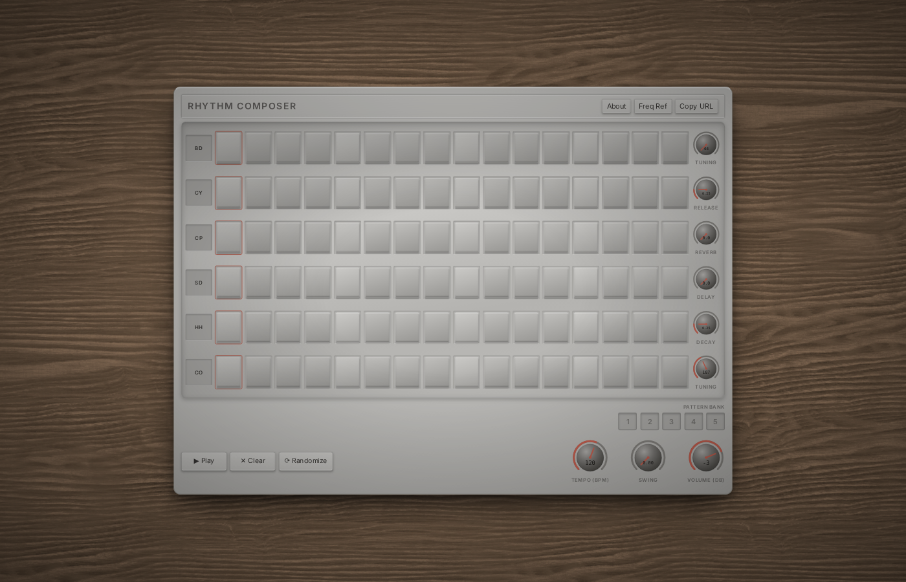

# Rhythm Composer

A browser-based drum machine and 16-step sequencer. Play, create, and edit drum patterns in real-time. Built with React and TypeScript; all synthesis runs in-browser via [Csound](https://csound.com/) compiled to WebAssembly.

## Instruments

The grid is a 6-row × 16-step sequencer representing one 4/4 measure (each step = 1/16th note). Each row is a synthesised drum sound, with a dedicated control knob on the right:

| Row | Sound  | Knob        |
|-----|--------|-------------|
| BD  | Kick   | Tuning (Hz) |
| CY  | Cymbal | Release     |
| CP  | Clap   | Reverb      |
| SD  | Snare  | Delay       |
| HH  | Hi-hat | Decay       |
| CO  | Conga  | Tuning (Hz) |

All synthesis uses physically-informed Csound opcodes (membrane models, FM metallic noise, filtered burst noise) running in an AudioWorklet off the main thread.

## Controls

- **Play / Pause** — starts or stops the sequencer; Csound initialises on first play
- **Tempo (BPM)** — 10–200 BPM, takes effect on the next scheduled step
- **Swing** — adds a time offset to odd steps for a shuffled feel
- **Volume (dB)** — master output level

## Entering Patterns

Click any cell to toggle it on or off. Active cells light up and trigger their instrument at the corresponding step.

**Long-press** (or right-click) an active cell to open the per-cell editor, where you can set:
- **Velocity** — how hard the hit plays (0–100%)
- **Probability** — chance the step fires on any given pass (0–100%)

The playhead (yellow outline) moves across the grid in real-time. Patterns can be edited while playing.

## Pattern Bank

Five save slots sit below the grid. Click an empty slot to save the current pattern (including all knob values and BPM). Click a filled slot to recall it. Long-press a filled slot to overwrite or clear it.

## Sharing Patterns

The URL updates automatically as you edit — every step, knob value, and BPM is encoded in the query string. Copy and share the URL to send your exact pattern to someone else.

## Tech Stack

- **React 19** + **TypeScript**
- **Csound WASM** (`@csound/browser`) — synthesis and effects in an AudioWorklet
- **Web Audio API** lookahead scheduler — hardware-clock timing with swing support
- **Vite** — build tooling
- **SCSS** — styling
